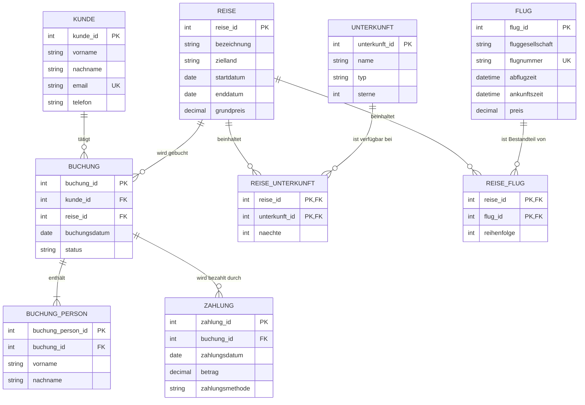

#itl

# ERM-Diagramm – Online-Reisebuchung

## Begründung

- `REISE_UNTERKUNFT`, `REISE_FLUG` und `BUCHUNG_PERSON` lösen die n:m-Beziehungen beziehungsweise die Mehrpersonenbuchung auf.
- Reiseziel, Fluggesellschaft und Zahlungsmethode bleiben als Attribute erhalten, da für sie keine zusätzlichen Stammdaten erforderlich sind.
- Eine Buchung kann mehrere Zahlungen enthalten und gilt bei vorhandenem Zahlungseingang als abgeschlossen.
