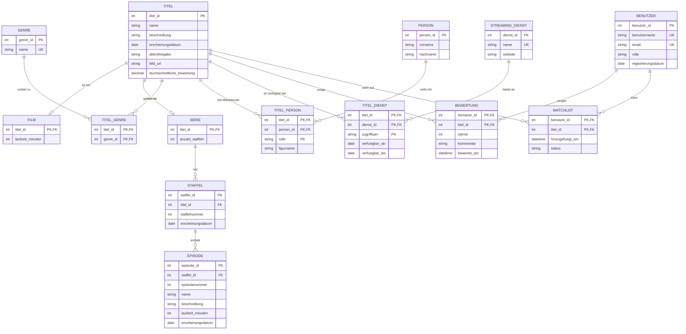

#itl

# ERM-Diagramm – Streaming-Portal

## Erste Entwurfsannahmen

- `TITEL` enthält die gemeinsamen Daten von Filmen und Serien. `FILM` und `SERIE` ergänzen die jeweils speziellen Daten.
- Eine Serie besitzt mehrere Staffeln, eine Staffel mehrere Episoden. Filme besitzen keine Staffeln oder Episoden.
- `TITEL_PERSON` löst die n:m-Beziehung zwischen Titeln und Personen auf. Über `rolle` kann eine Person beispielsweise als Schauspieler oder Regisseur zugeordnet werden; `figurname` ist nur bei Schauspielrollen relevant.
- `TITEL_DIENST` löst die n:m-Beziehung zwischen Titeln und Streaming-Diensten auf. `zugriffsart` kann beispielsweise `Abo`, `Leihen` oder `Kaufen` enthalten.
- `BEWERTUNG` und `WATCHLIST` verwenden jeweils einen zusammengesetzten Primärschlüssel aus Benutzer und Titel. Dadurch kann ein Benutzer einen Titel nur einmal bewerten und nicht doppelt auf die Watchlist setzen.
- `BENUTZER.rolle` unterscheidet zwischen normalen Benutzern (`user`) und Administratoren (`admin`). Zulässig sind ausschließlich diese beiden Werte.
- `durchschnittliche_bewertung` in `TITEL` ist als abgeleiteter Wert gedacht. Für eine strengere Normalisierung sollte dieser Wert nicht gespeichert, sondern mit SQL aus `BEWERTUNG` berechnet werden.

## Noch zu prüfen

- Ob Episoden ebenfalls bewertet, gesucht oder in die Watchlist aufgenommen werden sollen.
- Welche zusätzlichen Filter das Mockup genau benötigt, zum Beispiel Sprache, Land oder Erscheinungsjahr als eigener Filterbereich.
- Ob `zugriffsart` als eigene Tabelle modelliert werden soll, falls die Werte zentral verwaltet werden müssen.
