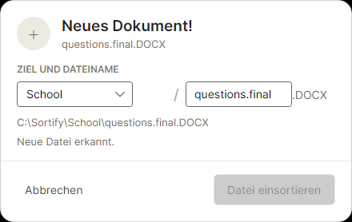

# Einfache Download-Erkennung

Stand: 23.10.2026. Teilumsetzung von Issue #29 / MUSS M4.2.1.

## Ablauf

1. Nach dem Laden der Einstellungen wird der gespeicherte Eingangsordner ueberwacht.
2. `FolderMonitor` meldet neue oder umbenannte Dateien ueber `FileSystemWatcher`.
3. `DownloadMonitorController` oeffnet auf dem Avalonia-UI-Thread das vorhandene Popup.
4. Das Popup zeigt den echten Dateinamen und die Endung. Die Zielordner stammen aus der Hauptoberflaeche; Originalname und bestehende Zielauswahl werden uebernommen.
5. Ordnerwechsel und App-Ende beenden die bisherige Ueberwachung und schliessen die automatischen Popups.

Temporaere Namen mit `.crdownload`, `.part`, `.partial`, `.tmp` und Office-Sperrdateien mit `~$` werden ignoriert. Die Umbenennung auf den endgueltigen Namen wird erkannt. Derselbe Pfad wird pro Sitzung nur einmal gemeldet, solange die Datei nicht geloescht wird.

## Bewusst kleiner Umfang

- Nur neue Dateien in der ersten Ordnerebene, keine nachtraegliche Verarbeitung vorhandener Dateien.
- Keine Pruefung, ob eine Datei vollstaendig heruntergeladen, stabil oder lesbar ist. Eine Datei mit endgueltigem Namen kann deshalb bereits waehrend des Schreibens angezeigt werden.
- Keine Warteschlange: Fuer mehrere neue Dateien koennen mehrere Popups gleichzeitig erscheinen.
- Keine Regelauswertung, Vorschlagsanbieter, KI-Vorbereitung oder API-Aufrufe.
- Keine Dateioperationen; Einsortieren ist deaktiviert. Abbrechen oder Schliessen veraendert keine Datei.
- Watcher-Fehler werden angezeigt. Die erneute Ordnerauswahl startet die Ueberwachung neu.

Issue #29 bleibt offen: Insbesondere Verfuegbarkeitspruefung und Anbindung der Regelengine fehlen noch.

## Testen

`dotnet run --project src/Sortify.App` starten, einen Testordner auswaehlen und eine neue Datei hineinlegen. Das Popup muss ihren Namen und ihre Endung anzeigen. Eine Datei mit temporaerer Endung wird erst nach der Umbenennung angeboten.

Automatisierte Tests pruefen Dateiereignisse, temporaere Namen, Ordnerwechsel, echte Popup-Anzeige und unveraenderte Quelldateien. Ein Headless-Test erzeugt `download-popup.png` im Build-Ausgabeverzeichnis der App-Tests. Windows-spezifische Fensterdekoration wird damit nicht geprueft.

