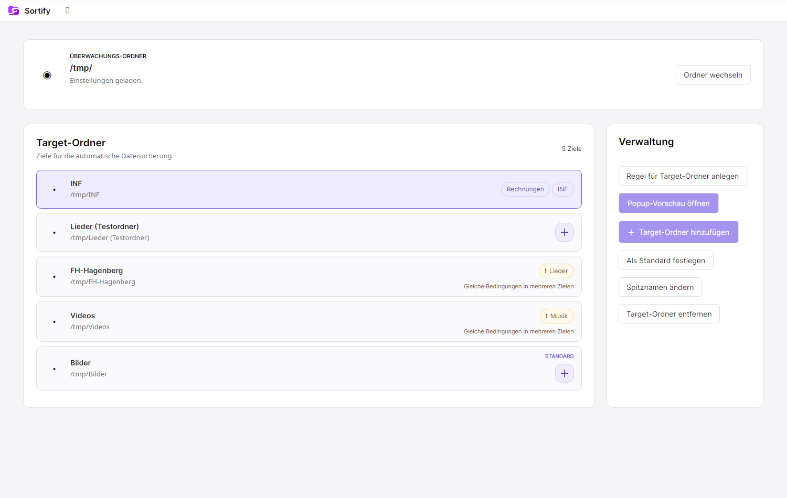
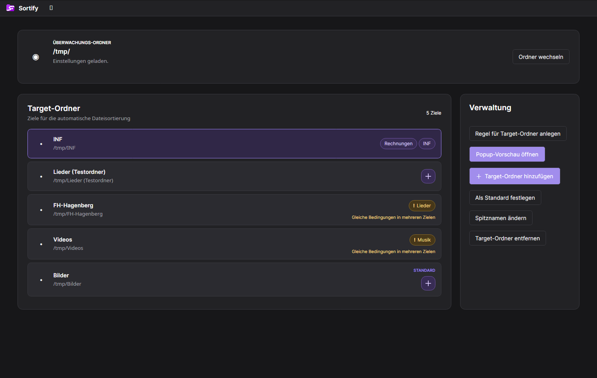
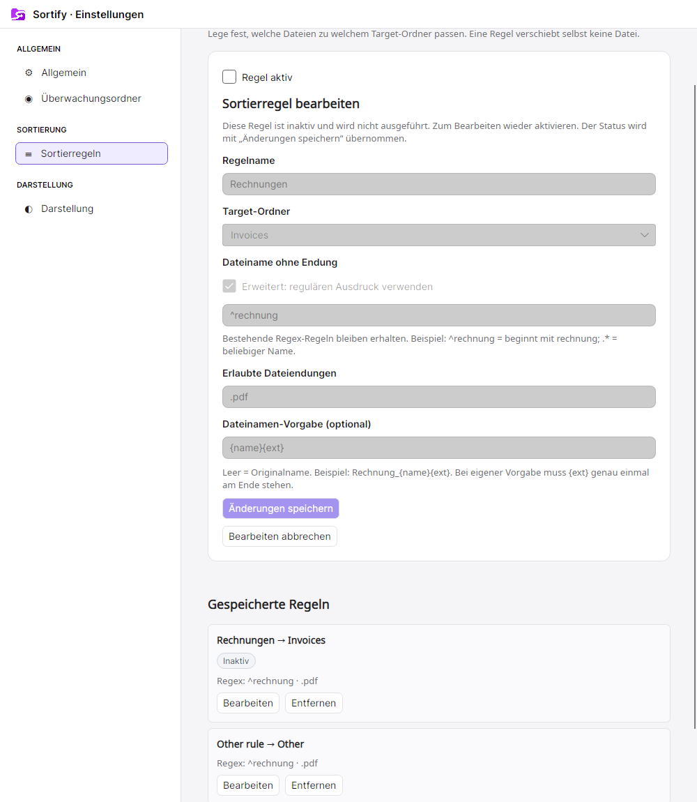
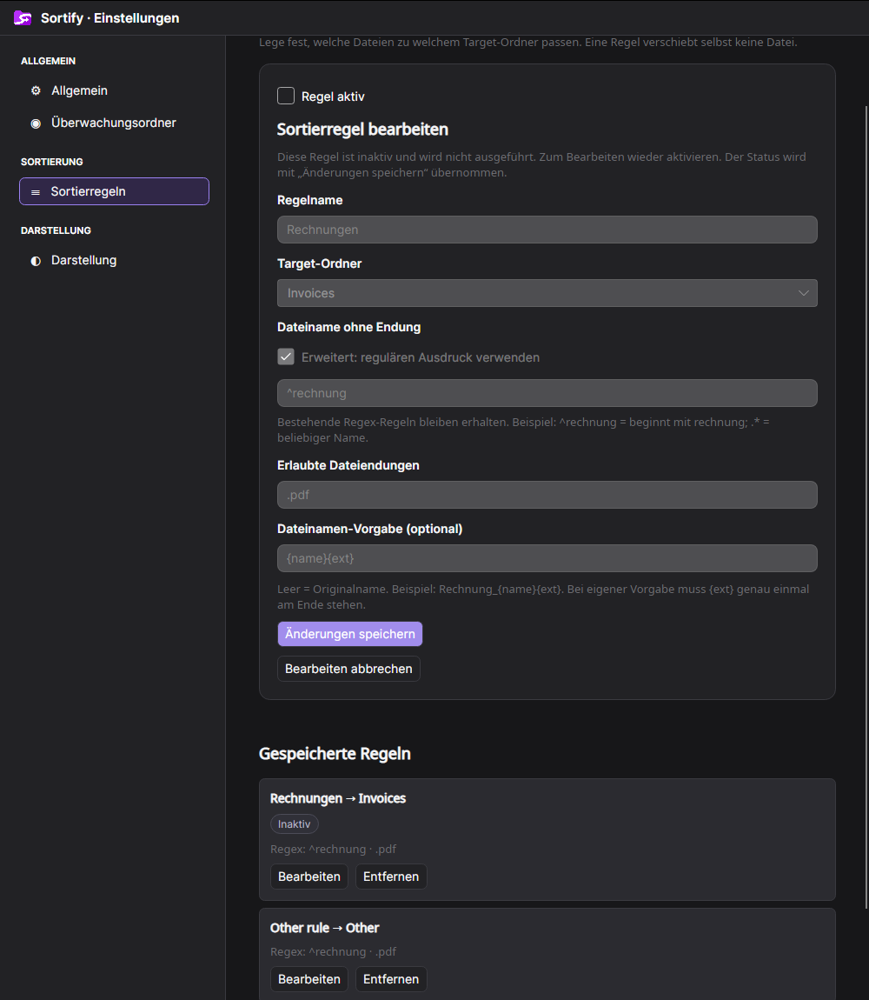

# Regel-Tags an Target-Ordnern

Arbeitsstand für #70, 28. Oktober 2026.

## Darstellung und Bedienung

Die Target-Karten zeigen rechts die Namen der zugeordneten Sortierregeln als klickbare, abgerundete Tags. Die Zuordnung erfolgt ausschließlich über stabile Target-IDs. Namen oder Pfade werden nicht als Ersatz für fehlende Referenzen verwendet.

- Violett: zugeordnete Regel.
- Violetter, quadratischer Plus-Button mit weichen Ecken: Das Target hat keine eigene Regel. Ein Klick öffnet die Neuanlage mit vorbelegtem Target. Das Target bleibt manuell und als Standardziel verwendbar. Diese Darstellung ersetzt im #74-Arbeitsstand die frühere rote Kennzeichnung „Keine Regel“.
- Gelb/Amber mit Ausrufezeichen: aktive Regeln mit gleichen Erkennungsbedingungen und gleicher Priorität sind mehreren Targets zugeordnet. Eine kurze Erklärung steht direkt in der Karte; der Tooltip nennt die weiteren Ziele.
- Grau: eine vorhandene, deaktivierte Regel. Sie bleibt anklickbar, erzeugt aber keine aktive Konfliktwarnung.

Ein Klick auf einen Regeltag öffnet Einstellungen → Sortierregeln und lädt exakt diese Regel über ihre ID zur Bearbeitung. Die Ansicht springt zur Maske und fokussiert das Namensfeld. Der Plus-Button öffnet die Neuanlage mit vorbelegtem Target. Eine nicht mehr vorhandene Regel wird ausdrücklich gemeldet; es wird keine ähnlich benannte Regel geöffnet.

Tags sind eigenständige Buttons neben dem Ordnerbutton, keine ineinander verschachtelten Buttons. Sie lassen sich mit Tastatur bedienen und besitzen zugängliche Beschriftungen. Tag-Klicks starten keine Ordner-Verschiebegeste. Der Kartenkörper behält Auswahl und Drag-and-drop. Lange Namen werden im Tag gekürzt und stehen vollständig im Tooltip; mehrere Tags umbrechen innerhalb ihres rechten Bereichs. Die Standardziel-Markierung bleibt separat sichtbar.

## Definition der Konfliktkennzeichnung

Vom Benutzer bestätigt: Entscheidend sind die Erkennungsbedingungen und die gleiche Priorität, unabhängig vom Regelnamen.

Verglichen werden erlaubte Dateiendungen, die relative Pfadbedingung, die Namensbedingungen und die Priorität. Bei einfachen Bedingungen werden Reihenfolge, doppelte UND-Bedingungen und Groß-/Kleinschreibung des wörtlichen Suchtextes ignoriert. Die Reihenfolge, Mehrfachnennung und Groß-/Kleinschreibung erlaubter Endungen ändern die Definition ebenfalls nicht. Regelname, Umbenennungsvorgabe und Zielpfad gehören nicht zur Erkennung.

Mindestens zwei unterschiedliche vorhandene Targets sind nötig. Deaktivierte Regeln sowie Regeln mit ungültiger Definition oder ungültiger Target-Referenz werden von der Konfliktkennung ausgeschlossen. Vorhandene Regex-Regeln werden anhand identischer Muster und identischer relativer Pfadbedingungen verglichen. Es findet keine allgemeine semantische Regex-Analyse statt; auch zwischen erweiterten Regex- und einfachen Regeln wird keine Gleichwertigkeit erraten. Unterschiedliche Suchmuster können sich trotzdem überschneiden. Die gelbe Markierung bezeichnet daher einen potenziellen Zielkonflikt, keinen Beweis, dass bereits eine konkrete Datei betroffen ist.

`RuleConflictDetector` ermittelt diese Gruppen deterministisch in Core. Die Regelengine, ihre Prioritäten und Dateioperationen bleiben unverändert.

## Aktualisierung und Speicherung

Tags werden aus dem aktuellen gespeicherten Stand abgeleitet und nicht separat gespeichert. Das Einstellungsformat bleibt unverändert. Anlegen, Bearbeiten, Entfernen, Target-Neuzuordnung und Target-Änderungen aktualisieren die Anzeige nach Abschluss des Speichervorgangs. Bei einem Speicherfehler bleibt die bisherige Anzeige erhalten. Geöffnete Datei-Popups behalten weiterhin ihren angezeigten Vorschlag.

## Light- und Darkmode

Alle Tagfarben verwenden dynamische, getrennte Theme-Ressourcen für Hintergrund, Text und Rahmen. Warnungen besitzen zusätzlich ein Ausrufezeichen und erklärenden Text; der Zustand wird nicht ausschließlich über Farbe vermittelt.

Die folgenden Aufnahmen wurden automatisiert mit Headless-Avalonia und ausschließlich synthetischen Testdaten erzeugt:

## Verifikation

Release-Build ohne Fehler oder Warnungen. 399 Tests erfolgreich, darunter:

- Konfliktdefinition unabhängig vom Namen, Bedingungs-/Endungsreihenfolge und Umbenennungsvorgabe.
- Keine Konfliktwarnung bei unterschiedlicher Priorität, anderen Bedingungen, deaktivierten Regeln, ungültigen Regeln oder nur einem Ziel.
- Unmittelbare Tag-Aktualisierung nach Anlegen, Umbenennen, Entfernen und Neuzuordnung; Erhalt bei Speicherfehlern.
- Light-/Darkmode mit verschiedenen Tagfarben und direkten Mausklicks zur richtigen Regel einschließlich Fokus.
- Plus-Button als Einstieg zur Neuanlage, keine verschachtelten Buttons und erhaltene Drag-and-drop-Ordnersortierung.

Die manuelle Prüfung in der laufenden Anwendung steht noch aus. Die Neugestaltung der gesamten Regelübersicht und andere Plattformkorrekturen sind separate Aufgaben.

## Aktivstatus bedienen

Beim Bearbeiten steht die Checkbox „Regel aktiv“ als erstes Formularelement. Ist sie nicht gesetzt, sind Regelname, Zielauswahl, Bedingungen, Suchtext, Dateiendungen und Umbenennungsvorgabe gesperrt. Checkbox, Speichern und Abbrechen bleiben bedienbar. Beim Öffnen einer inaktiven Regel erhält die Checkbox den Fokus.

Der Status wird erst mit „Änderungen speichern“ übernommen. Beim Deaktivieren werden ausschließlich die gespeicherten Parameter mit `IsEnabled = false` erhalten; ungespeicherte Änderungen an den danach gesperrten Feldern werden nicht übernommen. Beim erneuten Aktivieren können die Parameter bearbeitet werden und müssen gültig sein. Eine Regel mit entferntem Target kann deaktiviert werden; zum Aktivieren muss ein gültiges Target zugeordnet sein.

Neue Regeln sind automatisch aktiv; bei der Neuanlage wird keine Aktiv-Checkbox angeboten. Die Regelliste zeigt deaktivierte Regeln mit „Inaktiv“. Die zugehörigen Target-Tags werden grau; Konfliktwarnungen werden nach dem Speichern neu berechnet. Ein Speicherfehler erhält gespeicherten Status und Anzeige sowie den noch offenen Checkbox-Entwurf. Abbrechen verändert nichts.

`MainViewModel.SetRuleEnabledAsync` verwendet dieselbe Sperre und Prüfung auf einen veralteten Regelstand wie die übrige Regelbearbeitung. Das Einstellungsformat bleibt unverändert.

Zusätzliche Tests prüfen den automatisch aktiven Neuanlagestatus, Abbrechen, Speicherfehler, Deaktivieren trotz fehlendem Target, gesperrte UI-Felder bei bedienbarer Checkbox und Speichern, Erhalt gespeicherter Parameter trotz ungültigem Entwurf, Persistenz nach erneutem Laden sowie graue Tags und Konfliktänderungen. Beide Farbmodi sind automatisiert geprüft.

